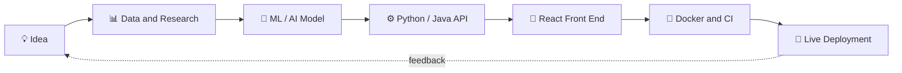

<div align="center">


<a href="https://readme-typing-svg.demolab.com">

</a>

<br/>

<p>
<a href="https://codersayan.vercel.app/"></a>
<a href="https://www.linkedin.com/in/codersayan/"></a>
<a href="mailto:sayanmandal7212@gmail.com"></a>
<a href="https://github.com/codersayan0"></a>
</p>


</div>

---

## 👨‍💻 About me

```python
class SayanMandal:
    role = "B.Tech CSE Student | 2023–2027"
    roles = [
        "AI & Machine Learning Developer",
        "Python Full-Stack Developer",
        "Java Developer",
        "Web Developer",
    ]
    currently_building = ["MediMitra", "AgroPulse", "SmartRoom"]
    philosophy = "Learn by building. Ship it. Improve with every iteration."
```

I'm a Computer Science student who turns ideas into useful, intelligent, **deployed** applications. I work across the stack: machine learning models, Python APIs, Java, and modern React front ends, with a focus on how AI can solve practical problems in healthcare, agriculture and education.

- 🔭 Building **MediMitra**, an AI-assisted multilingual healthcare platform.
- 🌱 Shipping **AgroPulse** and **SmartRoom**, ML-driven tools for farming and smart classrooms.
- 🧠 Exploring **Generative AI, RAG, NLP and applied machine learning**.
- 🛠️ Building end-to-end products with **Python, FastAPI, React, Java and MongoDB**.
- 🤝 Open to **internships, collaborations and open-source contributions**.

---

## 🚀 Live projects

<div align="center">

| Project | What it does | Stack | Links |
|:--|:--|:--|:--|
| 🏥 **MediMitra** | Multilingual AI patient case-taking and management (English, Bengali, Hindi) | React · FastAPI · MongoDB · Gemini | [Live](https://medimitra-codersayan.vercel.app/) · [Code](https://github.com/codersayan0/MediMitra) |
| 🌾 **AgroPulse** | Smart agriculture assistant with crop, fertilizer and disease insights | FastAPI · ML models · Weather and market APIs | [Live](https://agropulse-codersayan.vercel.app/) · [Code](https://github.com/codersayan0/AgroPulse) |
| 🏫 **SmartRoom** | Smart classroom platform for modern learning environments | Python · Web | [Live](https://smart-classroom-sayan.vercel.app/) |
| 🎬 **MediaDrop DevOps** | Containerised audio/video processing utility with CI automation | FastAPI · Docker · GitHub Actions | [Live](https://video-audio-devops.onrender.com/) · [Code](https://github.com/codersayan0/video-audio-devops) |

</div>

---

## ⭐ Featured work

<table>
<tr>
<td width="50%" valign="top">

### 🏥 MediMitra
**AI-assisted healthcare platform**

- Patient and doctor workflows
- AI interview and report summarisation
- English, Bengali and Hindi support
- React, FastAPI, MongoDB, Gemini

[🌐 Live demo](https://medimitra-codersayan.vercel.app/) · [📦 Repository](https://github.com/codersayan0/MediMitra)

</td>
<td width="50%" valign="top">

### 🌾 AgroPulse
**Smart agriculture assistant**

- Crop and fertilizer recommendations
- Weather and market-price integration
- Plant disease analysis
- FastAPI and ML models

[🌐 Live demo](https://agropulse-codersayan.vercel.app/) · [📦 Repository](https://github.com/codersayan0/AgroPulse)

</td>
</tr>
<tr>
<td width="50%" valign="top">

### 🏫 SmartRoom
**Smart classroom experience**

- Modern, responsive classroom interface
- Built for learning and engagement
- Deployed on Vercel

[🌐 Live demo](https://smart-classroom-sayan.vercel.app/)

</td>
<td width="50%" valign="top">

### 🎬 MediaDrop DevOps
**Containerised media utility**

- FastAPI media-processing tools
- Docker development environment
- GitHub Actions automation
- Deployed on Render

[🌐 Live demo](https://video-audio-devops.onrender.com/) · [📦 Repository](https://github.com/codersayan0/video-audio-devops)

</td>
</tr>
<tr>
<td width="50%" valign="top">

### 🩺 MediAssist AI
**Medical decision-support prototype**

- Symptom-based prediction workflow
- Medical report analysis
- Python backend with trained ML models

[📦 Repository](https://github.com/codersayan0/MediAssist-AI)

</td>
<td width="50%" valign="top">

### 📄 ATS Resume Checker
**NLP-powered resume matcher**

- Extracts skills from resumes
- Compares them with job descriptions
- Semantic similarity matching

[📦 Repository](https://github.com/codersayan0/ATS-Resume-Checker)

</td>
</tr>
<tr>
<td colspan="2" valign="top">

### 🤖 Sayan's Chatbot
**Multimodal AI assistant** with a conversational interface, voice input and response, and image understanding, built with Python, Gemini API and Gradio.

[📦 Repository](https://github.com/codersayan0/Sayan-Chatbot)

</td>
</tr>
</table>

<p align="center"><a href="https://github.com/codersayan0?tab=repositories"></a></p>

---

## 🧰 Tech stack

<div align="center">
<br/>
<br/>

</div>

<br/>

| Focus | Tools & Technologies |
|:--|:--|
| **Languages** | Python, Java, C, JavaScript, HTML, CSS |
| **AI / ML** | TensorFlow, Keras, PyTorch, Scikit-learn, OpenCV, Hugging Face |
| **Generative AI** | Gemini API, LangChain, RAG, Transformers |
| **Full-Stack** | React, FastAPI, Flask, REST APIs |
| **Data** | NumPy, Pandas, Matplotlib, Seaborn |
| **Databases** | MongoDB, MySQL |
| **DevOps & Tools** | Docker, GitHub Actions, Git, GitHub, VS Code, Google Colab |
| **Deployment** | Vercel, Render |

---

## 🧭 How I build



---

## 💼 Experience

| Period | Role | Organisation |
|:--|:--|:--|
| Aug – Sep 2025 | Python Development Intern | Cognifyz Technologies |
| Aug – Sep 2025 | Python Intern | BroskiesHub |

---

## 📈 GitHub activity

<div align="center">


<br/><br/>

<a href="https://github.com/codersayan0?tab=repositories"></a>
<a href="https://github.com/codersayan0?tab=repositories"></a>
<a href="https://github.com/codersayan0?tab=repositories"></a>

</div>

---

## 🐍 Contribution garden

<div align="center">

</div>

---

## 📬 Let's connect

<div align="center">

I'm looking for **internships and collaborations** in AI/ML, Python and full-stack development.

<a href="https://codersayan.vercel.app/">Portfolio</a> ·
<a href="https://www.linkedin.com/in/codersayan/">LinkedIn</a> ·
<a href="mailto:sayanmandal7212@gmail.com">Email</a> ·
<a href="https://github.com/codersayan0">GitHub</a>

<br/><br/>

**Build with curiosity. Turn ideas into intelligent experiences.**


</div>
