  

## 🤝 Let's Connect

<i>I'm always excited to collaborate on impactful projects, discuss ideas, or just have a tech chat.</i>

## 🧑‍💻 Who am I?

<h3 align="center">✨ My interests:</h3>

  

> *Turning ideas into intelligent, deployed products — from ML models and Python APIs to polished React interfaces and live launches.*

- 🎓 **B.Tech CSE student** (2023 – 2027)
- 🔭 Building **MediMitra**, **AgroPulse** and **SmartRoom**
- 🧠 Exploring **Generative AI, RAG, NLP and applied ML**
- 💬 Ask me about **Python, Java, FastAPI, React & ML**
- 💼 Python intern at **Cognifyz Technologies** and **BroskiesHub**
- 📫 Reach me at **sayanmandal7212@gmail.com**
- 🤝 Open for **internships, collaborations and open source**

 

## 🚀 Live Projects

| Project | What it does | Stack | Links |
|:--|:--|:--|:--|
| 🏥 **MediMitra** | Multilingual AI patient case-taking and management (English, Bengali, Hindi) | React · FastAPI · MongoDB · Gemini | [Live](https://medimitra-codersayan.vercel.app/) · [Code](https://github.com/codersayan0/MediMitra) |
| 🌾 **AgroPulse** | Smart agriculture assistant with crop, fertilizer and disease insights | FastAPI · ML models · Weather and market APIs | [Live](https://agropulse-codersayan.vercel.app/) · [Code](https://github.com/codersayan0/AgroPulse) |
| 🏫 **SmartRoom** | Smart classroom platform for modern learning environments | Python · Web | [Live](https://smart-classroom-sayan.vercel.app/) |
| 🎬 **MediaDrop DevOps** | Containerised audio/video processing utility with CI automation | FastAPI · Docker · GitHub Actions | [Live](https://video-audio-devops.onrender.com/) · [Code](https://github.com/codersayan0/video-audio-devops) |

<table>
<tr>
<td width="50%" valign="top">

### 🩺 MediAssist AI
Symptom-based prediction and medical report analysis with a Python backend and trained ML models.

[📦 Repository](https://github.com/codersayan0/MediAssist-AI)

</td>
<td width="50%" valign="top">

### 📄 ATS Resume Checker
NLP-powered resume matcher that extracts skills and compares them with job descriptions using semantic similarity.

[📦 Repository](https://github.com/codersayan0/ATS-Resume-Checker)

</td>
</tr>
<tr>
<td colspan="2" valign="top">

### 🤖 Sayan's Chatbot
Multimodal AI assistant with a conversational interface, voice input and response, and image understanding, built with Python, Gemini API and Gradio.

[📦 Repository](https://github.com/codersayan0/Sayan-Chatbot)

</td>
</tr>
</table>

## 💻 Tech Stack & Tools

<table>
<tr>
<td align="center" width="50%">

### 🎨 Frontend Development
 

  

</td>
<td align="center" width="50%">

### ⚙️ Backend Development
 

  

</td>
</tr>
<tr>
<td align="center" width="50%">

### 🗄️ Database & Cloud
 

  

</td>
<td align="center" width="50%">

### 🧰 Tools & DevOps
 

  

</td>
</tr>
</table>

### 🧠 AI/ML Frameworks & Tools

  
  
  
  
  
  
  
  
  
  

## 💼 Experience

| Period | Role | Organisation |
|:--|:--|:--|
| Aug – Sep 2025 | Python Development Intern | Cognifyz Technologies |
| Aug – Sep 2025 | Python Intern | BroskiesHub |

## 📊 GitHub Analytics

  
  

  
  
  

  
  
  

## 🐍 Contribution Snake

<picture>
  <source media="(prefers-color-scheme: dark)" srcset="https://raw.githubusercontent.com/codersayan0/codersayan0/output/github-contribution-grid-snake-dark.svg">
  <source media="(prefers-color-scheme: light)" srcset="https://raw.githubusercontent.com/codersayan0/codersayan0/output/github-contribution-grid-snake.svg">
  
</picture>

# :fountain_pen: Quote of the Day

> [!TIP]
> Liked something here? Drop a :star: on the repositories. It really helps!

