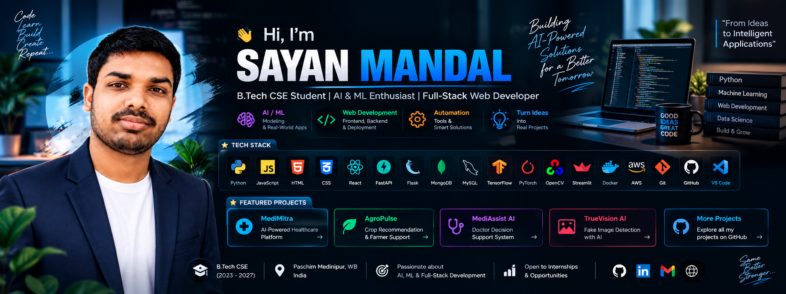

<div align="center">



<a href="https://readme-typing-svg.demolab.com">

</a>

<p>
<a href="https://codersayan.vercel.app/"></a>
<a href="https://www.linkedin.com/in/codersayan/"></a>
<a href="mailto:sayanmandal7212@gmail.com"></a>
<a href="https://github.com/codersayan0"></a>
</p>


</div>

---

## 👋 About me

```python
class SayanMandal:
    role = "B.Tech CSE Student | 2023–2027"
    focus = ["AI & Machine Learning", "Python", "Full-Stack Web Development"]
    currently_building = "AI-powered applications"
    philosophy = "Learn by building. Improve with every iteration."
```

I'm a Computer Science student who enjoys transforming ideas into useful, intelligent applications. I build with Python, machine learning, APIs, and modern web technologies—and love exploring how AI can solve practical problems.

- 🔭 Building **MediMitra**, an AI-assisted healthcare platform.
- 🧠 Exploring **Generative AI, RAG, NLP, and applied machine learning**.
- 🛠️ Developing end-to-end applications with **Python, FastAPI, React, and MongoDB**.
- 🤝 Open to internships, collaborative projects, and open-source contributions.

---

## 🧰 Tech toolbox

<div align="center">
<br/>
<br/>

</div>

| Focus | Tools & Technologies |
|---|---|
| **Languages** | Python, C, Java, JavaScript, HTML, CSS |
| **AI / ML** | TensorFlow, Keras, PyTorch, Scikit-learn, OpenCV, Hugging Face |
| **Generative AI** | Gemini API, LangChain, RAG, Transformers |
| **Web & APIs** | React, FastAPI, Flask, REST APIs |
| **Data** | NumPy, Pandas, Matplotlib, Seaborn |
| **Databases** | MongoDB, MySQL |
| **Tools** | Git, GitHub, VS Code, Google Colab, Docker |

---

## ✨ Featured projects

<table>
<tr>
<td width="50%" valign="top">

### 🏥 MediMitra
**AI-assisted healthcare platform**

A multilingual patient case-taking and management experience.

- Patient and doctor workflows
- AI interview and report summarisation roadmap
- English, Bengali, and Hindi support
- React, FastAPI, MongoDB, Gemini

[Repository](https://github.com/codersayan0/MediMitra) · [Live demo](https://medimitra-codersayan.vercel.app/)

</td>
<td width="50%" valign="top">

### 🌾 AgroPulse
**Smart agriculture assistant**

Machine-learning recommendations and agricultural insights.

- Crop and fertilizer recommendations
- Weather and market-price integration
- Plant disease analysis
- FastAPI and ML models

[Repository](https://github.com/codersayan0/AgroPulse)

</td>
</tr>
<tr>
<td width="50%" valign="top">

### 🩺 MediAssist AI
**Medical decision-support prototype**

- Symptom-based prediction workflow
- Medical report analysis
- Python backend and trained ML models

[Repository](https://github.com/codersayan0/MediAssist-AI)

</td>
<td width="50%" valign="top">

### 📄 ATS Resume Checker
**NLP-powered resume matcher**

- Extracts skills and information from resumes
- Compares resumes against job descriptions
- Semantic similarity matching

[Repository](https://github.com/codersayan0/ATS-Resume-Checker)

</td>
</tr>
<tr>
<td width="50%" valign="top">

### 🤖 Sayan's Chatbot
**Multimodal AI assistant**

- Conversational interface
- Voice input and response
- Image understanding workflow
- Python, Gemini API, and Gradio

[Repository](https://github.com/codersayan0/Sayan-Chatbot)

</td>
<td width="50%" valign="top">

### 🎬 MediaDrop DevOps
**Containerised media utility**

- FastAPI media-processing tools
- Docker development environment
- GitHub Actions automation

[Repository](https://github.com/codersayan0/video-audio-devops)

</td>
</tr>
</table>

<p align="center"><a href="https://github.com/codersayan0?tab=repositories"></a></p>

---

## 💼 Experience

| Period | Role | Organisation |
|---|---|---|
| Aug – Sep 2025 | Python Development Intern | Cognifyz Technologies |
| Aug – Sep 2025 | Python Intern | BroskiesHub |

---

## 📈 GitHub activity

<div align="center">


</div>

---

## 🐍 Contribution garden

<div align="center">

</div>

---

## 🌐 Find me around the web

<div align="center">

<a href="https://codersayan.vercel.app/">Portfolio</a> ·
<a href="https://www.linkedin.com/in/codersayan/">LinkedIn</a> ·
<a href="mailto:sayanmandal7212@gmail.com">Email</a> ·
<a href="https://github.com/codersayan0">GitHub</a>

<br/><br/>

**Build with curiosity. Turn ideas into intelligent experiences.**


</div>
